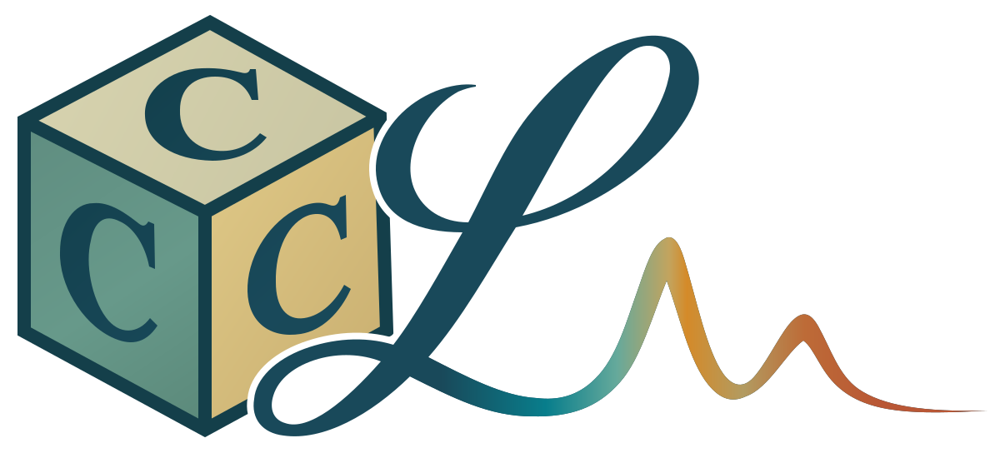

# C³L (Coupled-Cluster Coupled Lindblad)

<p align="center">
  
</p>

C³L (Coupled-Cluster Coupled Lindblad, "C cubed L") applies coupled-cluster theory to non-Markovian impurity dynamics. By representing bath memory with coupled Lindblad pseudomodes, it provides a scalable route to correlated steady states, dynamical Green functions, spectra, and nonequilibrium transport in multiorbital systems with general two-body interactions.

## Install

C³L requires Python 3.11 or newer.

```bash
python -m pip install c3l
```

The installation includes JAX and [RealTimeBath](https://github.com/Hertz4/RealTimeBath) for bath fitting. In Python, use `import c3l`.

CPU and GPU calculations use the same installation. On Linux x86-64 and ARM64, CUDA 13 dependencies are installed automatically. GPU execution requires a compatible NVIDIA GPU and driver; see the [JAX installation guide](https://docs.jax.dev/en/latest/installation.html).

For some examples using additional utilities, install the optional benchmarking tools:

```bash
python -m pip install "c3l[benchmark]"
```

### From source

From the root of a downloaded or cloned source tree:

```bash
python -m pip install .
```

<details>
<summary>For developers</summary>

For development, use `python -m pip install -e ".[test]"`; run the tests with `python -m pytest`.

</details>

## Quick start

This CPU example computes a CCSD steady state and its $\mathcal S_{1,3}$ spectral function for an impurity coupled to two bath orbitals.

<details>
<summary>Show the CCSD and response example</summary>

```python
import numpy as np
from c3l import FermionicLindbladModel
from c3l.cc.factorized import factorized_cc_problem
from c3l.cc.component_tensor import (
    ComponentStaticProblem, ComponentEOMProblem, component_eom_context, component_eom_sources,
)
from c3l.cc.component_solver import solve_component_ccsd
from c3l.cc.eom import eom_ccsd_problem
from c3l.cc.component_response import ComponentSigmaOperator, component_retarded_green

model = FermionicLindbladModel(
    E=np.array([[-0.6, 0.28, 0.28], [0.28, -1.2, 0.0], [0.28, 0.0, 1.2]]),
    gamma_loss=np.diag([0.0, 0.06, 0.48]),
    gamma_gain=np.diag([0.0, 0.48, 0.06]),
    U=1.2,
)
problem = ComponentStaticProblem.compile(
    factorized_cc_problem(model, "CCSD")
)
solution = solve_component_ccsd(problem)
print(f"CCSD residual: {solution.packed_residual_norm:.2e}")

eom = eom_ccsd_problem(problem.oracle)
context = component_eom_context(
    ComponentEOMProblem.compile(eom, problem, charge=1), solution.amplitudes
)
omega = np.linspace(-4.0, 4.0, 81)
response = component_retarded_green(
    ComponentSigmaOperator(context), component_eom_sources(context), omega, eta=0.0
)
np.savez("spectrum.npz", omega=omega, G_R=response.retarded, A=-response.retarded.imag / np.pi)
```

`spectrum.npz` contains the impurity Green function and spectral density $A(\omega)=-\Im G^R(\omega)/\pi$ per spin.

</details>

## Examples

See the [examples guide](examples/README.md) for more examples. These optional scripts are provided in the source repository.

## Citing C³L

The following paper should be cited when utilizing the C³L program package:

Hao-En Li, Zhen Huang, and Lin Lin, [Efficient simulations of spectra and transport for multiorbital quantum impurities](), **arXiv:2610.XXXXX**

If your calculation employed the bath fitting based on [RealTimeBath](https://github.com/Hertz4/RealTimeBath), cite

Zhen Huang, Gunhee Park, Garnet Kin-Lic Chan, and Lin Lin, [Coupled Lindblad Pseudomode Theory for Simulating Open Quantum Systems](https://journals.aps.org/prl/abstract/10.1103/qfkp-jc7s), **Phys. Rev. Lett. 2026**, 136, 090403

## License

[MIT License](LICENSE). Copyright (c) 2026 Hao-En Li.
